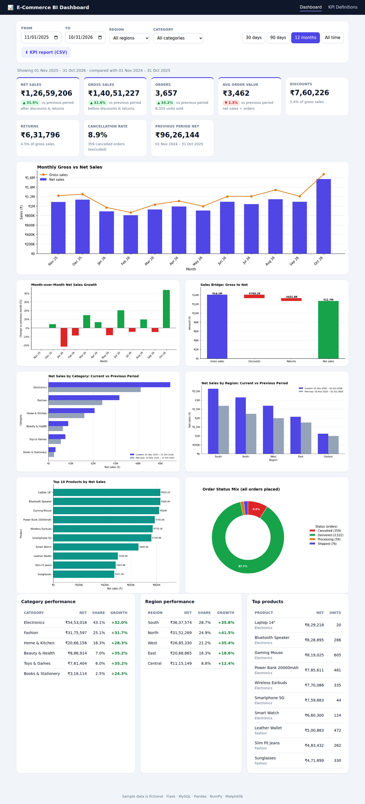

# 📊 E-Commerce Business Intelligence Dashboard

[](https://github.com/lokeshkumar0722/E-Commerce_business_Intelligence_Dashboard/actions/workflows/ci.yml)
[](https://codespaces.new/lokeshkumar0722/E-Commerce_business_Intelligence_Dashboard)

A management-oriented analytics dashboard for an online store. It turns raw order data into **KPIs, revenue trends, category / region / product comparisons and period-over-period growth**, served by a Flask web app and REST API.

> Project 15 – *Python Flask Data Analytics Projects*. Focus: **aggregated business performance** (no customer-level segmentation).



## Features

- **KPI cards** – gross sales, net sales, orders, average order value, discounts, returns, units sold, cancellation rate – each with **growth vs the previous period**
- **7 Matplotlib charts** – monthly gross vs net, month-over-month growth, gross→net bridge, category and region comparison (current vs previous period), top-10 products, order-status mix
- **Filters** – date range (+ quick presets), region, category
- **KPI Definitions page** – a documented formula and inclusion/exclusion rule for every KPI (`/kpi-definitions`)
- **REST API + CSV export** of the KPI report
- Input validation, parameterised SQL, JSON error responses, DB constraints (`CHECK`, `FOREIGN KEY`)
- 13 unit/API tests whose expected values were calculated by hand

## Tech stack

| Layer | Technology |
|-------|-----------|
| Backend | Python 3.10+, Flask |
| Database | MySQL 8.0.16+ (PyMySQL) — or SQLite for a zero-setup demo |
| Analysis | Pandas (aggregation, period comparison), NumPy (percentage change, rates) |
| Charts | Matplotlib (rendered server-side to PNG) |
| Frontend | HTML, CSS, vanilla JavaScript |

## Run it on GitHub (no installation)

1. Click the **Open in GitHub Codespaces** badge above (or **Code → Codespaces → Create codespace on main**).
2. Wait about a minute while dependencies install. The app starts automatically.
3. The dashboard opens in a browser tab. If not, open the **Ports** tab and click the globe icon next to port **5000**.

## Quick start on your own computer (no database server needed)

```bash
git clone https://github.com/lokeshkumar0722/E-Commerce_business_Intelligence_Dashboard.git
cd E-Commerce_business_Intelligence_Dashboard

python -m venv .venv
source .venv/bin/activate          # Windows: .venv\Scripts\activate
pip install -r requirements.txt

cp .env.example .env               # Windows: copy .env.example .env
python app.py
```

Open **http://127.0.0.1:5000**. On first start the app creates the tables and loads ~7,000 fictional orders (Nov 2024 – Oct 2026) automatically.

## Deploy on Render

1. Push this repo to GitHub.
2. In Render: **New → Blueprint** (or **New → Web Service**) and select the repository.
3. Blueprint reads [`render.yaml`](render.yaml) automatically. For a manual Web Service use:
   - Build command: `pip install -r requirements.txt`
   - Start command: `gunicorn "app:create_app()" --workers 1 --threads 4 --timeout 120 --bind 0.0.0.0:$PORT`
   - Env vars: `PYTHON_VERSION=3.12.3`, `DB_ENGINE=sqlite`, `AUTO_SEED=true`
4. Open the `onrender.com` URL once the deploy finishes.

## Using MySQL

1. Install MySQL 8.0.16 or newer and make sure it is running.
2. Edit `.env`:
   ```ini
   DB_ENGINE=mysql
   MYSQL_HOST=localhost
   MYSQL_PORT=3306
   MYSQL_USER=root
   MYSQL_PASSWORD=your_password
   MYSQL_DATABASE=ecommerce_bi
   ```
3. Run `python app.py`. The database and tables are created automatically (the schema is in [`sql/schema_mysql.sql`](sql/schema_mysql.sql)) and sample data is loaded if the tables are empty.

> Credentials live only in `.env`, which is git-ignored. Never commit it.

## Database schema

```
products(product_id PK, product_name UNIQUE, category)
orders(order_id PK, order_date, order_status, region)
order_items(item_id PK, order_id FK, product_id FK, quantity, unit_price, discount, return_amount)
```
Constraints: `quantity > 0`, prices/discounts/returns `>= 0`, `discount + return_amount <= quantity × unit_price`, status ∈ {Delivered, Shipped, Processing, Cancelled}.

## KPI definitions (summary)

| KPI | Formula |
|-----|---------|
| Gross Sales | Σ quantity × unit_price |
| Discounts / Returns | Σ discount / Σ return_amount |
| **Net Sales** | Gross − Discounts − Returns |
| Orders | distinct order_id |
| AOV | Net Sales ÷ Orders |
| Cancellation Rate | Cancelled orders ÷ all orders placed × 100 |
| Growth | (Current − Previous) ÷ \|Previous\| × 100 |

**Treatment rules:** cancelled orders are excluded from all revenue KPIs (reported separately via the cancellation rate); discounts and returns are subtracted on the line they belong to, so category/region/product views always reconcile with the totals; the *previous period* is the window of equal length ending the day before the selected start date; growth shows `n/a` when the previous value is 0. Full details: run the app and open `/kpi-definitions`, or see [`kpi_definitions.py`](kpi_definitions.py).

## REST API

All endpoints accept optional `start`, `end` (`YYYY-MM-DD`), `region` and `category` query parameters. Invalid input returns HTTP 400 with `{"error": "..."}`.

| Method & path | Description |
|---------------|-------------|
| `GET /api/health` | Service / DB status |
| `GET /api/filters` | Regions, categories, available date range |
| `GET /api/kpis` | Current KPIs, previous-period KPIs and growth % |
| `GET /api/revenue/monthly` | Monthly gross/net/orders + MoM growth |
| `GET /api/revenue/category` | Net sales, share and growth per category |
| `GET /api/revenue/region` | Net sales, share and growth per region |
| `GET /api/products/top` | Top 10 products by net sales |
| `GET /api/kpi-definitions` | KPI formulas and treatment rules |
| `GET /api/report.csv` | Downloadable KPI report |
| `GET /charts/<name>.png` | Chart image (`monthly_revenue`, `mom_growth`, `sales_bridge`, `category_comparison`, `region_comparison`, `top_products`, `order_status`) |

Example:

```bash
curl "http://127.0.0.1:5000/api/kpis?start=2026-01-01&end=2026-03-31&region=South"
```

## Command-line tools

```bash
python manage.py init-db                       # create tables
python manage.py seed --reset --orders 7000    # (re)load sample data
python manage.py export-report --out reports   # KPI CSV + definitions CSV + all chart PNGs
```

## Tests

```bash
python -m unittest discover -s tests -v
```

Covers KPI formulas, cancelled-order exclusion, previous-period window, growth maths, breakdown reconciliation, filters, API validation, chart rendering and database constraints.

## Project structure

```
├── app.py               Flask application factory
├── routes.py            Pages, REST API, chart endpoints, input validation
├── analytics.py         KPI aggregation and period comparison (Pandas + NumPy)
├── charts.py            Matplotlib chart rendering
├── kpi_definitions.py   KPI formulas / treatment rules (single source of truth)
├── db.py                MySQL / SQLite access layer (parameterised queries)
├── config.py            Settings from environment variables
├── seed_data.py         Fictional sample-data generator
├── manage.py            CLI: init-db, seed, export-report
├── sql/                 schema_mysql.sql, schema_sqlite.sql
├── templates/ static/   Web UI
└── tests/               Unit and API tests
```

## Publishing to GitHub

```bash
git init
git add .
git commit -m "Initial commit: E-Commerce BI Dashboard"
git branch -M main
git remote add origin https://github.com/lokeshkumar0722/E-Commerce_business_Intelligence_Dashboard.git
git push -u origin main
```

The sample data is entirely fictional.
